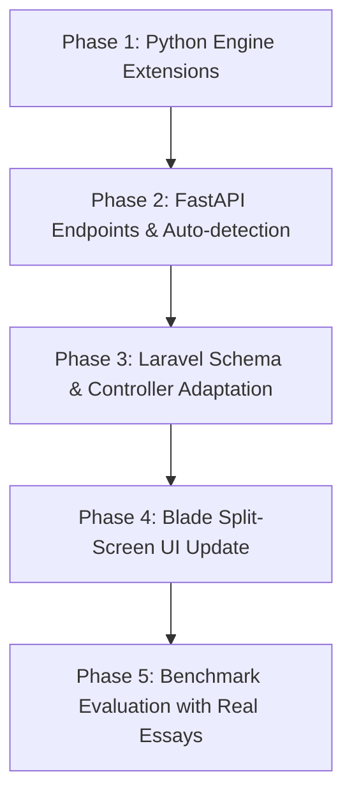

# Evidentia: Architectural Plan for Essay & Subjective Text Evaluation

## 1. Executive Summary & Feasibility Assessment

### Can the current system handle essays?
- **Current State: NO (Minimal / Inadequate).**
  The current engine is strictly coupled to formal academic citations. Specifically:
  - `claim_extractor.py` contains a hard gate: `if not in_text_citations: return []`.
  - Without references or in-text markers, citation parsing, Open Access retrieval via Crossref/OpenAlex, and RAG-based NLI matching are bypassed entirely.
  - The essay receives only a single univariate sentence-burstiness score, leaving the UI showing `0% Practical Coverage`, `0 Claims`, and an empty evidence panel.
- **Future State with Planned Features: YES (Highly Capable).**
  The underlying infrastructure—**FastAPI microservice, local Ollama LLM (`llama3.2:3b`), document segmenter, Toulmin claim representation, background processing jobs, and the interactive split-screen UI**—is already ~75% aligned with what is required.
  By extending the pipeline with an **"Essay Mode" (Citation-Free Rhetorical & Stylometric Analysis)**, Evidentia can assess subjective essays with high accuracy, zero reliance on external bibliographic databases, and full explainability.

---

## 2. Architectural Comparison: Research Papers vs. Subjective Essays

| Pipeline Component | 🔬 Academic Research Mode (Existing) | ✍️ Subjective Essay Mode (Proposed) |
| :--- | :--- | :--- |
| **Input Type** | Papers with APA citations & References section | Thematic, argumentative, literary, or personal essays |
| **Claim Extraction** | Tied strictly to citation markers (e.g. `(Smith, 2020)`) | **Rhetorical Toulmin Mining** (Thesis, Sub-claims, Grounds, Rebuttals) |
| **Evidence Grounding** | External Open Access full text (OpenAlex / Crossref / Unpaywall) | **Internal Grounding** (Quotes, textual evidence, concrete historical/personal examples) |
| **Core AI Failure Mode Detected** | Hallucinated DOIs, phantom citations, claim-source mismatch | **Hedged neutrality, high abstraction, formulaic 5-paragraph symmetry, AI clichés** |
| **Top Ribbon Metrics** | Practical Coverage (% OA), Claims Supported | **Voice Authenticity, Argument Depth, Cliché Density, Paragraph Symmetry** |
| **Right Pane Inspector** | Matched academic paper passage & DOI link | **Toulmin Argument Anatomy & Internal Evidence Inspector** |

---

## 3. Core Engine Extensions (Python Microservice)

### A. Automatic Mode Detection (`parser.py` & `main.py`)
- Automatically detect the document type upon upload:
  - If a recognizable **References / Bibliography** section and $>1$ formal citation marker (`(Author, Year)`) exist $\to$ **`RESEARCH_PAPER`**.
  - If no bibliography is present or citations are $<1$ $\to$ **`ESSAY`**.
  - Allow manual override via the upload form in Laravel.

---

### B. Rhetorical Toulmin Miner (`essay_miner.py`)
*Toulmin argumentation originated in philosophical and legal argumentation, not scientific paper citations. In an essay, arguments consist of:*
1. **Major Thesis & Sub-claims:** Core argumentative assertions.
2. **Internal Grounds (Evidence):**
   - Direct quotes from source material (e.g., analyzing *Hamlet* or *The Great Gatsby*).
   - Specific historical events, names, dates, or empirical examples.
   - Personal reflections or observational data.
3. **Warrants:** The analytical reasoning connecting the ground to the claim.
4. **Counterarguments & Rebuttals:** Addressing opposing viewpoints.

#### AI Detection Signals in Argument Mining:
- **Grounding Depth Ratio:** AI essays generate broad declarative claims with **shallow or circular grounds** (e.g., claiming "Greed ruins societies" followed by "This demonstrates how greed is bad", rather than analyzing concrete historical/literary events).
- **Rebuttal Absence:** AI-generated subjective essays almost always lack authentic rebuttals or concession-qualifiers.

---

### C. Multi-Factor Stylometric Fingerprinting (`ai_indicator.py` Upgrade)
Upgrade the heuristic indicator to calculate four essay-specific vectors:

1. **AI Cliché & Formulaic Transition Density:**
   - **Vocabulary Scanner:** Tracks overrepresented LLM tokens (*delve, testament, tapestry, pivotal, multifaceted, paramount, beacon, foster, intricate, resonate, vibrant, poised*).
   - **Transition Template Scanner:** Tracks formulaic discourse markers (*"Furthermore,"*, *"Moreover,"*, *"It is important to remember,"*, *"A deeper look reveals,"*, *"In conclusion, by embracing..."*).
   - Output: `cliche_ratio = count(cliches) / total_words`.

2. **Abstract vs. Concrete Entity Ratio:**
   - LLMs rely heavily on abstract conceptual nouns (*dimensions, paradigms, journeys, realms, impacts, nuances*).
   - Human essays contain concrete sensory anchors, specific proper names, dates, and localized terminology.
   - Output: Ratio of concrete nouns and proper entities to abstract concepts.

3. **Structural & Paragraph Symmetry:**
   - Human essays vary in pacing: punchy introductory hooks, long analytical paragraphs, short transitional sentences.
   - LLM essays exhibit near-zero variance in paragraph word counts (~100–120 words per paragraph).
   - Output: Standard deviation of paragraph word counts and sentence length variance.

4. **Sentence Starter Monotony:**
   - Measure entropy of the initial 2 words of every sentence.
   - AI essays heavily repeat Determiner + Noun sentence openings (*"The author...", "This conflict...", "The significance..."*).

---

### D. Local Ollama LLM Rhetorical Audit
Utilize the local Ollama instance (`llama3.2:3b`) for structured essay forensics without transmitting data to external APIs:
- **Audit Prompt Evaluates:**
  1. *Voice Authenticity:* Evaluates whether the voice exhibits genuine authorial stance or standardized, sanitized RLHF neutrality.
  2. *Hedging Index:* Flags excessive non-committal phrasing (*"While some believe X, others argue Y, suggesting a balanced approach is needed"*).
  3. *Specific Detail Audit:* Checks if textual claims reference actual scenes, passages, or verifiable details from the analyzed work.

---

## 4. Laravel Backend & Data Architecture

### Database Schema Updates
Add columns to support essay assessments without breaking research paper scans:

```php
// Migration: add_essay_fields_to_papers_table.php
Schema::table('papers', function (Blueprint $table) {
    $table->string('document_type')->default('auto'); // research_paper, essay, auto
    $table->float('voice_authenticity_score')->nullable(); // 0 - 100
    $table->float('cliche_density')->nullable();           // 0 - 100
    $table->float('concreteness_ratio')->nullable();        // 0.0 - 1.0
    $table->float('paragraph_variance')->nullable();        // standard deviation
    $table->json('essay_analysis_data')->nullable();        // detailed breakdown
});

// Migration: update_claims_table_for_essays.php
Schema::table('claims', function (Blueprint $table) {
    $table->string('claim_category')->nullable(); // thesis, sub_claim, ground, rebuttal
    $table->string('ground_type')->nullable();    // textual_quote, concrete_example, circular_generalization
});
```

### PaperController & Engine Integration
- In `EvidentiaEngineService.php`, forward the `document_type` parameter to the Python API.
- If `document_type == 'essay'`, route to `_process_evidentia_essay_pipeline()`.
- Persist extracted thesis, claims, grounds, and stylistic flags to `claims` and `evidence_matches`.

---

## 5. User Interface Adaptations (`show.blade.php`)

### Dual-Mode Dynamic View:
When `paper->document_type === 'essay'`:

1. **Top Ribbon Metrics:**
   - Replace *Practical OA Coverage* with **Voice Authenticity Index** (e.g. `78% Authentic Voice`).
   - Replace *Claims Distribution (Supported/Unsupported)* with **Argument Structure** (`4 Claims`, `3 Concrete Grounds`, `1 Rebuttal`).
   - Display **AI Stylistic Density Badge** (`Elevated Cliché Frequency` or `Natural Stylistic Variance`).

2. **Left Pane (Document Reader):**
   - Highlighting switches to:
     - 🟣 **Purple:** Central Thesis / Argumentative Claims.
     - 🟢 **Green:** Concrete Evidence / Grounded Quotes.
     - 🟡 **Amber:** Flagged AI Formulaic Transitions & Clichés (*"delve into"*, *"testament to"*).
     - 🔴 **Red:** Circular / Unsubstantiated Generalizations.

3. **Right Pane (Evidence & Rhetorical Inspector):**
   - Instead of looking for journal DOIs, displays the **Toulmin Argument Card**:
     - **Claim:** The student's assertion.
     - **Provided Ground:** The quote or example from the text.
     - **Authenticity Assessment:** Evaluates whether the ground truly substantiates the claim or merely repeats it in different words.
     - **Instructor Note & Override:** Retains manual review and grading capabilities.

---

## 6. Phased Implementation Roadmap



### Phase 1: Python Engine Extensions
- [ ] Create `python-engine/essay_miner.py` for citation-free Toulmin argument extraction using local Ollama.
- [ ] Expand `python-engine/ai_indicator.py` to calculate:
  - Cliché and transition frequency list.
  - Sentence opener entropy and paragraph symmetry.
  - Concrete entity vs. abstract noun ratio.

### Phase 2: FastAPI Endpoint Addition
- [ ] Add `POST /api/v1/assess-essay` to `python-engine/main.py`.
- [ ] Implement auto-detection heuristic in `parser.py` (`detect_document_type(text)`).

### Phase 3: Laravel Backend Integration
- [ ] Create migration for `document_type` and essay integrity metrics.
- [ ] Update `EvidentiaEngineService.php` to handle essay pipeline payloads.
- [ ] Update `PaperController.php` to accept essay submissions and pass document type flags.

### Phase 4: UI & Visual Explainability
- [ ] Update `resources/views/papers/create.blade.php` to include an optional "Document Mode" selector (Auto / Research Paper / Subjective Essay).
- [ ] Update `resources/views/papers/show.blade.php` with dynamic ribbon metrics and color-coded rhetorical highlights for essays.
- [ ] Upgrade the disclaimer modal to explain essay stylometric indicators.

### Phase 5: Verification & Benchmarking
- [ ] Add sample human and AI essays to `python-engine/test_dataset.json` for benchmarking precision and recall.
- [ ] Validate false positive rates on authentic non-native English (ESL) essays.

---

## 7. Key Design Principle: Avoiding False Accusations

Unlike commercial AI detectors that issue opaque "98% AI" accusations, Evidentia's essay mode must uphold its founding philosophy:
- **Inspectable Grounds:** Never accuse a student of AI generation based solely on a numerical score.
- **Rhetorical Breakdown:** Show the instructor *concrete patterns*: "This essay contains 12 formulaic transitions, 0 counterarguments, uniform paragraph length, and 0 concrete text citations."
- **Educational Dialogue:** Frame results as an **Argumentation & Originality Audit**, giving educators specific structural observations to discuss with the student.
