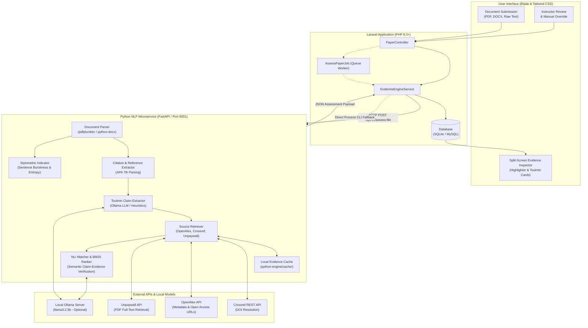
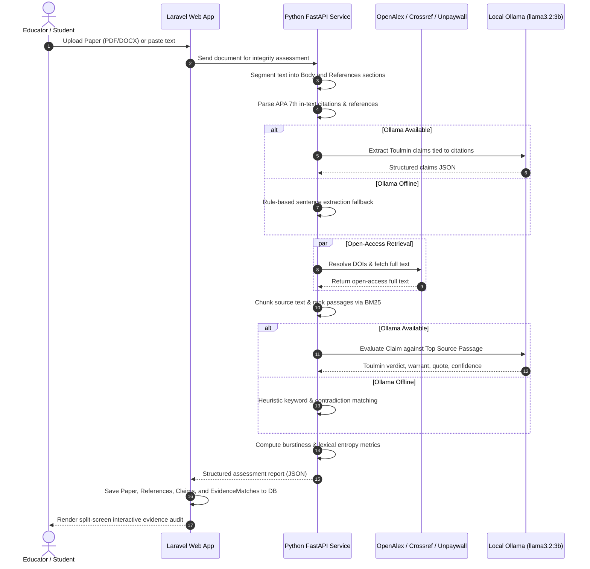
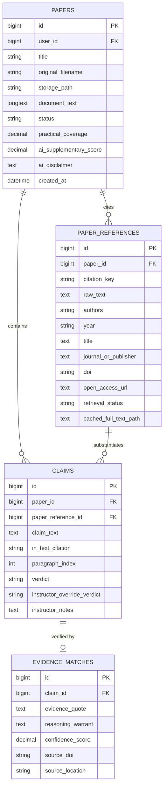

# Evidentia

Academic Evidence Integrity and Toulmin Argumentation Verification System

Evidentia is an open-source academic integrity platform that evaluates research papers and student submissions through inspectable evidence rather than opaque, probabilistic percentage scores. Instead of issuing black-box "AI detection" ratings, Evidentia extracts in-text citations and argumentative claims, cross-references citations against open-access scholarly databases (Crossref, OpenAlex, Unpaywall), retrieves peer-reviewed literature, and assesses whether cited sources genuinely substantiate the author's claims using Natural Language Inference (NLI) grounded in the Toulmin argumentation framework.

---

## Theoretical and Technical Foundations

Evidentia translates established theoretical frameworks in computational argumentation, open-access bibliometrics, and explainable natural language inference into a working verification pipeline. Every technical decision in the architecture addresses documented limitations in prior literature:

| Pipeline Component | Theoretical / Empirical Foundation | Methodological Grounding & Architectural Role |
| :--- | :--- | :--- |
| **Argument Deconstruction** | Toulmin (2003); Gupta et al. (2024); Turós et al. (2025) | Grounds argument decomposition into Claims, Grounds, and Warrants; justifies zero-shot LLM argument explication and demonstrates that Toulmin coding applies robustly to student writing. |
| **Retrieve-Then-Verify Paradigm** | Poliak et al. (2018); Wadden et al. (2020) | Prevents "hypothesis-only bias" where classifiers predict entailment without consulting evidence; justifies the retrieve-first architecture modeled after scientific claim verification (SciFact). |
| **Open-Access Retrieval** | Priem, Piwowar, & Orr (2022); Piwowar et al. (2018) | Adopts OpenAlex as a comprehensive scholarly index and empirically grounds the **Practical Coverage** ceiling by recognizing that only ~28–31% of scholarly literature is open access. |
| **Passage Candidate Ranking** | Robertson & Zaragoza (2009) | Employs the Probabilistic Relevance Framework (BM25) to isolate candidate evidence passages from full-text sources prior to inference. |
| **Four-Tier Verdict Taxonomy** | Nicholson et al. (2021); Kunnath et al. (2021); Haan (2025) | Generalizes citation-context classification (scite) and full-text verification (SemanticCite) into four standardized categories (`SUPPORTED`, `PARTIALLY_SUPPORTED`, `UNSUPPORTED`, `UNVERIFIABLE`). |
| **Explainable Warrants** | Camburu et al. (2018) | Implements Natural Language Explanations (e-SNLI) so the system generates inspectable justification warrants rather than unexplained labels. |
| **Stylometric Heuristic** | Gehrmann, Strobelt, & Rush (2019) | Adopts the Giant Language Model Test Room (GLTR) principle: statistical regularity is an inspectable visual heuristic for human decision support, never standalone proof. |
| **PDF Extraction Reliability** | Meuschke et al. (2023) | Acknowledges the benchmarked error variance and layout challenges of rule-based PDF parsing (`pdfplumber`) on academic documents. |
| **Citation Formatting Standard** | American Psychological Association (2020) | Implements the official APA 7th Edition specification for reference list parsing and in-text citation resolution. |
| **Pedagogical Ethics** | Deep et al. (2025) | Bases the non-punitive design on empirical studies documenting high false-positive rates and ethical harms of commercial AI detectors in higher education. |

---

## Architecture Overview

Evidentia is structured as a modular, hybrid architecture: a Laravel 12 application managing user interaction, database persistence, and presentation, paired with an asynchronous Python NLP microservice (FastAPI) executing document parsing, bibliographic resolution, literature retrieval, and semantic evidence matching.



---

## Verification Pipeline



---

## Core Functionalities

### 1. Document Ingestion and Segmentation
- Ingests academic papers in PDF, Microsoft Word (`.docx`), or plain text formats.
- Identifies and isolates the document body from the terminal bibliography based on APA 7th Edition structural conventions (American Psychological Association, 2020).
- Normalizes in-text citations (`(Author, Year)` or narrative formats) and pairs each marker with its corresponding bibliography record.

### 2. Toulmin Argumentation Claim Extraction
- Deconstructs student prose using Toulmin's (2003) model of argumentation, which recent empirical research demonstrates is effective for evaluating student writing on technical and AI topics (Turós et al., 2025):
  - **Claim:** The specific assertion, factual claim, or conclusion put forward by the student.
  - **In-Text Citation:** The formal bibliographic citation anchor tying the assertion to an external source.
  - **Grounds:** The empirical facts, quotations, or data retrieved from the cited scholarly publication.
  - **Warrant:** The analytical reasoning connecting the grounds to the claim.
- Operationalizes zero-shot argument explication (Gupta et al., 2024) using a local LLM prompt template, with automated fallback to syntactic sentence-window extraction when offline.

### 3. Multi-Tier Open-Access Literature Retrieval
- Resolves missing DOIs via the Crossref REST API.
- Leverages the OpenAlex catalog (Priem, Piwowar, & Orr, 2022) and the Unpaywall API to retrieve full-text open-access PDFs and text dumps.
- Implements thread-pooled parallel downloads backed by a local SHA-256 disk cache (`python-engine/cache/`).
- Computes **Practical Coverage**:
  $$\text{Practical Coverage} = \left(\frac{\text{Retrieved Open-Access References}}{\text{Total Cited References}}\right) \times 100$$
  This metric directly reflects the empirical findings of Piwowar et al. (2018), which establish that only ~28–31% of published scholarly literature is available via open access. Unretrievable or paywalled works are treated as an expected scope ceiling rather than student infractions.

### 4. Natural Language Inference (NLI) Verification
- **Mitigating Hypothesis-Only Bias:** Natural Language Inference systems evaluated without evidence frequently learn to predict entailment based solely on linguistic artifacts in the hypothesis (Poliak et al., 2018). Evidentia resolves this by enforcing a retrieve-then-verify workflow modeled after scientific fact verification benchmarks (Wadden et al., 2020).
- **Passage Selection:** Chunks retrieved full-text papers into sliding windows (200 words, 40-word overlap) and ranks relevance against the student claim using the BM25 probabilistic relevance framework (Robertson & Zaragoza, 2009).
- **Classification Taxonomy:** Maps claims into four standardized categories grounded in citation-intent classification (Nicholson et al., 2021; Kunnath et al., 2021) and AI-assisted citation auditing (Haan, 2025):
  - `SUPPORTED`: The retrieved excerpt directly substantiates the author's claim.
  - `PARTIALLY_SUPPORTED`: The source corroborates the domain or background, but the claim overstates findings, exaggerates statistical metrics, or omits caveats.
  - `UNSUPPORTED`: The retrieved text directly contradicts, disproves, or reports findings opposite to the assertion.
  - `UNVERIFIABLE`: The source is behind a commercial paywall, unindexed, or fails to address the claim topic.
- **Natural Language Warrants:** Rather than returning uninterpretable label probabilities, the engine generates an explicit explanatory warrant, adopting the explainable Natural Language Explanation (NLE) paradigm (Camburu et al., 2018).

### 5. Interactive Split-Screen Reader & Inspector
- **Left Pane (Document Reader):** Displays the submitted manuscript with dynamic, color-coded inline highlighters. Clicking any highlighted claim triggers synchronous navigation to its inspection card.
- **Right Pane (Evidence Inspector):** Houses individual Toulmin audit cards showing the student's assertion, the exact verbatim excerpt from the peer-reviewed literature, the reasoning warrant, match confidence, and direct DOI links.

### 6. Human-in-the-Loop Instructor Overrides
- Provides editable review accordions for instructors to override automated verdicts (e.g., when a source is verified through a physical textbook or library paywall) and record pedagogical grading notes.
- Maintains a clean audit trail by preserving the original automated analysis alongside instructor modifications.

### 7. Supplementary Stylometric Regularity Indicator
- Computes sentence burstiness (the coefficient of variation of sentence lengths) and unigram Shannon entropy.
- Implements the foundational philosophy of the Giant Language Model Test Room (Gehrmann, Strobelt, & Rush, 2019): statistical regularity serves strictly as an inspectable visual aid for human decision support, never as conclusive proof of machine authorship.
- Displays a mandatory modal disclaimer cautioning that low perplexity and structural uniformity naturally characterize formal academic discourse.

### 8. Institutional Audit Export
- Generates comprehensive, machine-readable JSON reports (`GET /papers/{id}/export/json`) suitable for departmental committees, accreditation evidence, or academic integrity review.

---

## Evaluation Dataset & Research Alignment

In strict alignment with the thesis Chapter 1 methodology and scope boundaries:
- **Zero Synthetic Text:** The benchmark dataset (`python-engine/test_dataset.json`) is composed **strictly of authentic, human-annotated peer-reviewed publications** (including landmark works by Vaswani et al., Devlin et al., He et al., and Brown et al.). No AI-generated papers, synthetic hallucinations, or simulated citations are present.
- **Balanced Four-Class Distribution:** Test instances represent balanced ground-truth distributions across all target verification classes (`SUPPORTED`, `PARTIALLY_SUPPORTED`, `UNSUPPORTED`, and unretrievable/paywalled cases for `UNVERIFIABLE`).
- **Reproducible Evaluation:** The evaluation script (`python-engine/eval.py`) benchmarks retrieval precision, recall, and NLI accuracy directly against human annotations.

---

## Model Capacity, Engineering Scope, and Limitations

To maintain academic rigor and transparent scholarly expectations, the system documents four key engineering constraints:

### 1. Local 3B Parameter Model Scope (`llama3.2:3b`)
- The reasoning engine uses a quantized 3B parameter model (`llama3.2:3b`) running locally via Ollama.
- **Feasibility Rationale:** Designed to run on accessible consumer hardware without cloud API costs, proprietary data transfer, or privacy vulnerabilities.
- **Capacity Limits:** A 3B parameter model performing zero-shot Toulmin explication and four-way NLI represents a lightweight undergraduate prototype. It will exhibit lower semantic precision on complex syntactic entailment compared to multi-billion parameter frontier models.
- **Empirical Focus:** Evidentia does not claim state-of-the-art NLI accuracy; performance is reported empirically against human-annotated benchmarks.

### 2. Rule-Based Fallback Boundaries
- When Ollama is offline, the system defaults to rule-based keyword extraction and BM25 overlap matching.
- While this guarantees operational resilience, heuristic fallbacks cannot capture nuanced rhetorical shifts, indirect contradictions, or domain-specific idioms.

### 3. PDF Ingestion Variance
- Document parsing utilizes `pdfplumber` and `python-docx`.
- As benchmarked by Meuschke et al. (2023), rule-based PDF extraction inherits well-documented error rates when handling multi-column academic layouts, complex mathematical notations, figure interruptions, and varied font encodings.

### 4. Ethical Safeguards Against False Accusations
- Commercial AI detection platforms produce opaque, unexplainable probability scores that suffer from documented false-positive disparities against non-native English writers and technical prose (Deep et al., 2025).
- Evidentia mitigates these risks by adhering to three non-punitive principles:
  1. **Evidence-First Verification:** Every challenge is anchored to an inspectable excerpt from the cited source.
  2. **Safe Defaults:** Paywalled or unretrievable sources default to `UNVERIFIABLE` rather than penalizing students.
  3. **Human Primacy:** Automated outputs are advisory; instructors maintain ultimate discretion through manual overrides.

---

## Data Model



---

## System Requirements & Dependencies

### Runtime Prerequisites
- **PHP:** Version 8.3 or higher with extensions: `pdo_sqlite` or `pdo_mysql`, `curl`, `mbstring`, `fileinfo`, `openssl`
- **Composer:** Version 2.2 or higher
- **Node.js:** Version 18.0 or higher with **NPM**
- **Python:** Version 3.10 or higher with **pip**
- **Database:** SQLite (default for development) or MySQL 8.0+ / MariaDB 10.5+
- **Ollama (Optional):** Version 0.3+ with model `llama3.2:3b`

### Tools & Documentation References
- [Laravel 12 Documentation](https://laravel.com/docs/12.x) - Backend application framework
- [FastAPI Documentation](https://fastapi.tiangolo.com/) - High-performance Python web framework
- [pdfplumber](https://github.com/jsvine/pdfplumber) - PDF text and layout extraction library
- [python-docx](https://python-docx.readthedocs.io/) - Microsoft Word document processing library
- [Ollama](https://ollama.ai/) - Local large language model execution runtime
- [Crossref REST API](https://www.crossref.org/documentation/retrieve-metadata/rest-api/) - Academic DOI resolution and metadata service
- [OpenAlex API](https://docs.openalex.org/) - Open catalog of global scholarly literature

### PHP Packages (`composer.json`)
- `laravel/framework`: ^11.0 / ^12.0
- `laravel/tinker`: ^3.0
- `laravel/boost`: ^2.10 (dev)
- `phpunit/phpunit`: ^12.0 (dev)

### Python Microservice Packages (`python-engine/requirements.txt`)
- `fastapi`: >= 0.100.0 (REST microservice API)
- `uvicorn`: >= 0.22.0 (ASGI application server)
- `pydantic`: >= 2.0.0 (Request validation)
- `requests`: >= 2.28.0 (HTTP client for scholarly APIs)
- `pdfplumber`: >= 0.10.0 (PDF document extraction)
- `python-docx`: >= 1.0.0 (DOCX document extraction)

### Frontend Dependencies (`package.json`)
- `tailwindcss`: ^4.0.0
- `@tailwindcss/vite`: ^4.0.0
- `vite`: ^8.0.0
- `concurrently`: ^10.0.3

---

## Installation & Setup Guide

### 1. Clone the Repository
```bash
git clone https://github.com/Ecuacion-Seth/Evidencia.git evidentia
cd evidentia
```

### 2. Configure Environment File
```bash
cp .env.example .env
```
Generate the application encryption key:
```bash
php artisan key:generate
```

### 3. Initialize Database
By default, the application runs on SQLite:
```bash
touch database/database.sqlite
```
If using MySQL, configure your `.env`:
```env
DB_CONNECTION=mysql
DB_HOST=127.0.0.1
DB_PORT=3306
DB_DATABASE=evidentia
DB_USERNAME=root
DB_PASSWORD=
```
Execute the database schema migrations:
```bash
php artisan migrate
```

### 4. Install PHP Dependencies
```bash
composer install
```

### 5. Install Frontend Dependencies and Build Assets
```bash
npm install
npm run build
```

### 6. Install Python Microservice Dependencies
Ensure Python 3.10+ is available:
```bash
cd python-engine
pip install -r requirements.txt
cd ..
```

### 7. Configure Local Ollama (Optional)
Evidentia functions out of the box with heuristic fallbacks if Ollama is not installed. To activate local LLM inference:
1. Install [Ollama](https://ollama.ai).
2. Download the Llama 3.2 3B parameter model:
   ```bash
   ollama pull llama3.2:3b
   ```
3. Ensure the Ollama daemon is active (`http://localhost:11434`).

---

## Running the Application

Evidentia consists of two collaborating services:

### Terminal 1: Start the Python FastAPI Engine
```bash
cd python-engine
uvicorn main:app --host 127.0.0.1 --port 8001 --reload
```
Confirm the service is operating at `http://127.0.0.1:8001/health`.

### Terminal 2: Start the Laravel Web Application
```bash
php artisan serve --port 8000
```
Open `http://127.0.0.1:8000` in your web browser.

### Terminal 3: Vite Development Server (Optional for UI edits)
```bash
npm run dev
```

### Asynchronous Queue Processing (Optional)
If running background jobs (`run_sync=false`):
```bash
php artisan queue:work --tries=3 --timeout=180
```

---

## Configuration & Environment Reference

### Laravel Environment Variables (`.env`)

| Variable | Default Value | Description |
| :--- | :--- | :--- |
| `APP_NAME` | `Evidentia` | Application name displayed in headers and audit metadata |
| `APP_URL` | `http://localhost:8000` | Base URL of the Laravel application |
| `DB_CONNECTION` | `sqlite` | Database driver (`sqlite`, `mysql`, `pgsql`) |
| `QUEUE_CONNECTION` | `database` | Background queue connection (`database`, `sync`, `redis`) |
| `FILESYSTEM_DISK` | `local` | Document storage disk (`storage/app/`) |

### Python Microservice Environment Variables

| Variable | Default Value | Description |
| :--- | :--- | :--- |
| `OLLAMA_HOST` | `http://localhost:11434` | Network address of local Ollama server |
| `OLLAMA_MODEL` | `llama3.2:3b` | Target Ollama model name |
| `ENGINE_PORT` | `8001` | Listening port for FastAPI microservice |

---

## Microservice API Endpoints

### `GET /health`
Returns health check status and configured Ollama host.

**Response:**
```json
{
  "status": "healthy",
  "service": "evidentia-engine",
  "ollama_host": "http://localhost:11434"
}
```

### `POST /api/v1/assess-file`
Processes an uploaded file from disk.

**Request Body:**
```json
{
  "file_path": "/absolute/path/to/paper.pdf",
  "title": "Comparative Study on Attention Mechanisms"
}
```

### `POST /api/v1/assess-text`
Processes raw text containing both document body and references.

**Request Body:**
```json
{
  "text": "The Transformer relies entirely on attention (Vaswani et al., 2017).\n\nReferences\nVaswani, A. et al. (2017). Attention is all you need.",
  "title": "Sample Paper"
}
```

---

## Directory Structure

```
Evidentia/
├── app/
│   ├── Http/
│   │   └── Controllers/
│   │       └── PaperController.php          # Submission handling, split-screen UI, and overrides
│   ├── Jobs/
│   │   └── AssessPaperJob.php               # Background job for queued document scans
│   ├── Models/
│   │   ├── Claim.php                        # Extracted Toulmin claim and verdict record
│   │   ├── EvidenceMatch.php                # Passage quote, warrant, and confidence score
│   │   ├── Paper.php                        # Main document submission model
│   │   └── PaperReference.php               # Cited bibliographic reference model
│   └── Services/
│       └── EvidentiaEngineService.php       # Microservice HTTP integration with CLI fallback
├── database/
│   └── migrations/                          # Schema definitions for papers, claims, references
├── python-engine/
│   ├── ai_indicator.py                      # Sentence burstiness and lexical entropy calculation
│   ├── cache/                               # Local persistent disk cache for retrieved full text
│   ├── citation_extractor.py                # APA 7th reference list parser and in-text matcher
│   ├── claim_extractor.py                   # Toulmin claim extractor (Ollama & heuristic)
│   ├── eval.py                              # Evaluation benchmark runner against ground truth
│   ├── main.py                              # FastAPI microservice entry point
│   ├── main_cli.py                          # Direct CLI execution entry point for Process fallback
│   ├── nli_matcher.py                       # Natural Language Inference and BM25 passage ranking
│   ├── parser.py                            # PDF and DOCX text extraction and segmenter
│   ├── requirements.txt                     # Python pip dependencies
│   ├── source_retriever.py                  # Crossref, OpenAlex, and Unpaywall API retriever
│   ├── test_dataset.json                    # Human-annotated academic benchmark dataset (no synthetic text)
│   └── test_engine.py                       # Python unit test suite
├── resources/
│   ├── css/
│   │   └── app.css                          # Tailwind CSS stylesheet
│   └── views/
│       ├── layouts/
│       │   └── app.blade.php                # Main application layout with dark mode toggle
│       └── papers/
│           ├── create.blade.php             # Document upload and paste form
│           ├── index.blade.php              # Scan history and submission table
│           └── show.blade.php               # Interactive split-screen evidence audit
├── routes/
│   └── web.php                              # Web application route definitions
└── tests/
    └── Feature/
        ├── AssessPaperJobTest.php           # Background job execution test
        └── PaperSubmissionFeatureTest.php   # End-to-end submission and report feature tests
```

---

## Running Tests

### Laravel Feature & Unit Tests
Run the PHPUnit test suite:
```bash
php artisan test
```

### Python NLP Engine Tests
Run the Python engine unit tests:
```bash
python -m unittest python-engine/test_engine.py
```

### Ground-Truth Benchmark Evaluation
Run the automated evaluation against the human-annotated dataset:
```bash
python python-engine/eval.py
```

---

## References

1. **American Psychological Association.** (2020). *Publication manual of the American Psychological Association* (7th ed.). https://doi.org/10.1037/0000165-000
2. **Camburu, O.-M., Rocktäschel, T., Lukasiewicz, T., & Blunsom, P.** (2018). e-SNLI: Natural language inference with natural language explanations. *Advances in Neural Information Processing Systems (NeurIPS 2018)*, 31, 9539–9549. https://doi.org/10.48550/arxiv.1812.01193
3. **Deep, P. D., Roy, S., & Sultana, S.** (2025). Evaluating the effectiveness and ethical implications of AI detection tools in higher education. *Information*, 16(10), 905. https://doi.org/10.3390/info16100905
4. **Gehrmann, S., Strobelt, H., & Rush, A. M.** (2019). GLTR: Statistical detection and visualization of generated text. *Proceedings of the 57th Annual Meeting of the Association for Computational Linguistics: System Demonstrations*, 111–116. https://doi.org/10.18653/v1/p19-3019
5. **Gupta, A., Zuckerman, E., & O'Connor, B. T.** (2024). Harnessing Toulmin's theory for zero-shot argument explication. *Proceedings of the 62nd Annual Meeting of the Association for Computational Linguistics (Volume 1: Long Papers)*, 10079–10098. https://doi.org/10.18653/v1/2024.acl-long.552
6. **Haan, S.** (2025). SemanticCite: Citation verification with AI-powered full-text analysis and evidence-based reasoning. *arXiv preprint*. https://doi.org/10.48550/arxiv.2511.16198
7. **Kunnath, S. N., Pride, D., & Knoth, P.** (2021). A meta-analysis of semantic classification of citations. *Quantitative Science Studies*, 2(4), 1170–1187. https://doi.org/10.1162/qss_a_00159
8. **Meuschke, N., Stange, N., Greiner, M., & Gipp, B.** (2023). A benchmark of PDF information extraction tools using a multi-task and multi-domain evaluation framework for academic documents. In *Information for a Better World: Normality, Virtuality, Physicality, Inclusivity (iConference 2023)* (pp. 383–405). Springer. https://doi.org/10.1007/978-3-031-28032-0_31
9. **Nicholson, J. M., Mlynek, M., Sintunavarat, C., Hepding, H., Li, J., Chawla, L., & Adams, R.** (2021). scite: A smart citation index that displays the context of citations and classifies their intent using deep learning. *Quantitative Science Studies*, 2(3), 882–898. https://doi.org/10.1162/qss_a_00146
10. **Piwowar, H., Priem, J., Larivière, V., Alperin, J. P., Matthias, L., Norlander, B., Farley, A., West, J., & Haustein, S.** (2018). The state of OA: A large-scale analysis of the prevalence and impact of Open Access articles. *PeerJ*, 6, e4375. https://doi.org/10.7717/peerj.4375
11. **Poliak, A., Naradowsky, J., Aparicio, A., Sheppard, R., Koehn, P., & Van Durme, B.** (2018). Hypothesis only baselines in natural language inference. *Proceedings of the 7th Joint Conference on Lexical and Computational Semantics (*SEM 2018)*, 180–191. https://doi.org/10.18653/v1/s18-2023
12. **Priem, J., Piwowar, H., & Orr, R.** (2022). OpenAlex: A fully-open index of scholarly works, authors, venues, institutions, and concepts. *arXiv preprint*. https://doi.org/10.48550/arxiv.2205.01833
13. **Robertson, S., & Zaragoza, H.** (2009). The probabilistic relevance framework: BM25 and beyond. *Foundations and Trends® in Information Retrieval*, 3(4), 333–389. https://doi.org/10.1561/1500000019
14. **Toulmin, S. E.** (2003). *The uses of argument* (Updated ed.). Cambridge University Press. https://doi.org/10.1017/cbo9780511840005
15. **Turós, M., Kárpáti, A., & Horváth, C.** (2025). A Toulmin model analysis of student argumentation on artificial intelligence. *Education Sciences*, 15(9), 1226. https://doi.org/10.3390/educsci15091226
16. **Wadden, D., Lin, S., Lo, K., Wang, L. L., van Zuylen, M., Cohan, A., & Hajishirzi, H.** (2020). Fact or fiction: Verifying scientific claims. *Proceedings of the 2020 Conference on Empirical Methods in Natural Language Processing (EMNLP 2020)*, 7534–7550. https://doi.org/10.18653/v1/2020.emnlp-main.609

---

## License

This project is open-source software licensed under the [MIT License](LICENSE).
