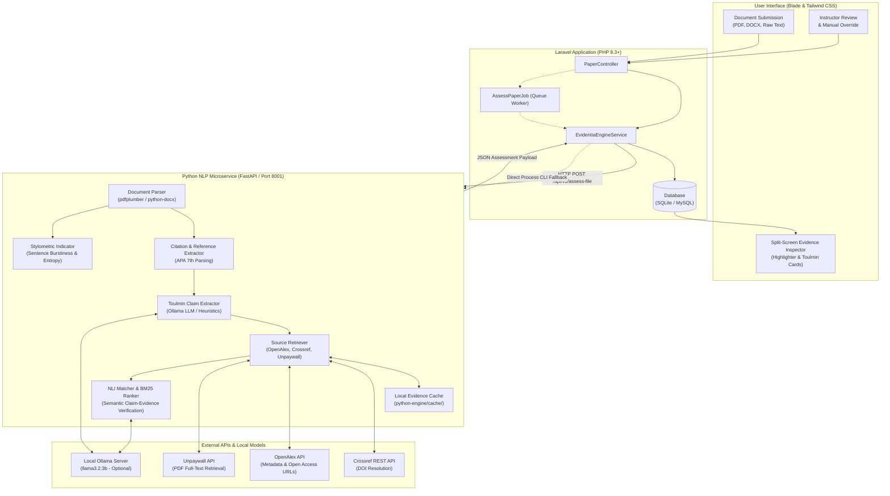
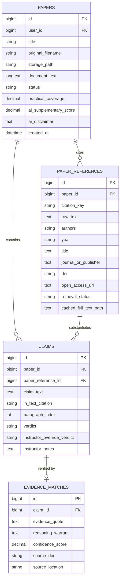

# Evidentia

Academic Evidence Integrity and Toulmin Argumentation Verification System

Evidentia is an open-source academic integrity platform that evaluates research papers and student submissions through inspectable evidence rather than opaque, probabilistic percentage scores. Instead of issuing black-box "AI detection" ratings, Evidentia extracts in-text citations and argumentative claims, cross-references citations against open-access scholarly databases (Crossref, OpenAlex, Unpaywall), retrieves peer-reviewed literature, and assesses whether cited sources genuinely substantiate the author's claims using Natural Language Inference (NLI) grounded in the Toulmin argumentation framework.

---

## Architecture Overview

Evidentia is designed as a modular, hybrid architecture: a Laravel 12 application handling user interactions, authentication, database persistence, and presentation, paired with a Python NLP microservice (FastAPI) responsible for document parsing, bibliographic resolution, open-access literature retrieval, and semantic evidence matching.



---

## Verification Pipeline


---

## Core Functionalities

### 1. Document Ingestion and Segmentation
- Ingests academic papers via PDF upload, Microsoft Word (`.docx`), or direct text pasting.
- Segments submissions into the primary document body and the bibliographic references section.
- Normalizes in-text citations and maps them directly to cited bibliography entries.

### 2. Toulmin Argumentation Claim Extraction
- Breaks down arguments into structured Toulmin argumentation components:
  - **Claim:** The specific assertion or factual conclusion made in the text.
  - **In-Text Citation:** The bibliographic citation anchor (e.g., `Vaswani et al., 2017`).
  - **Grounds:** The retrieved evidence excerpt from the referenced scholarly publication.
  - **Warrant:** The analytical reasoning establishing how the evidence relates to the claim.

### 3. Multi-Tier Open-Access Literature Retrieval
- Automated resolution of missing Digital Object Identifiers (DOIs) using the Crossref REST API.
- Integration with OpenAlex and Unpaywall to locate legally accessible open-access full-text PDFs and text dumps.
- Thread-pooled concurrent retrieval backed by a local filesystem cache (`python-engine/cache/`) to eliminate duplicate network traffic.
- Reports **Practical Coverage**: the exact proportion of cited external sources retrievable as open-access full text, establishing an honest verification ceiling.

### 4. Natural Language Inference (NLI) Verification
- Chunks retrieved source documents into overlapping semantic passages and ranks relevance against the claim using BM25 term weighting.
- Classifies claims into four distinct verdicts:
  - `SUPPORTED`: The cited source directly substantiates the assertion.
  - `PARTIALLY_SUPPORTED`: The source supports the general context, but the claim overstates findings or omits essential qualifications.
  - `UNSUPPORTED`: The cited source refutes, contradicts, or presents conclusions contrary to the assertion.
  - `UNVERIFIABLE`: The source is behind a paywall, unavailable as open access, or does not address the claim topic.

### 5. Interactive Split-Screen Reader & Inspector
- **Left Pane (Document Reader):** Displays the submitted text with interactive color-coded highlights representing each claim. Selecting any highlighted claim scrolls and activates its corresponding evidence card.
- **Right Pane (Evidence Inspector):** Presents individual Toulmin audit cards containing the extracted student claim, the retrieved source quote, the verification warrant, match confidence score, and direct DOI/open-access links.

### 6. Human-in-the-Loop Instructor Overrides
- Enables instructors to review automated verdicts, apply manual adjustments (e.g., if a source was verified via a print volume or institutional library subscription), and record pedagogical notes.
- Manual overrides are clearly flagged while preserving the original automated analysis for transparency.

### 7. Supplementary Stylometric Regularity Indicator
- Evaluates sentence burstiness (variance of sentence lengths) and lexical entropy.
- Paired with strict cautionary disclaimers affirming that structural regularity can occur naturally in formal academic prose and must never be used as ground-truth proof of machine generation.

### 8. Institutional Audit Export
- Machine-readable JSON export endpoint (`GET /papers/{id}/export/json`) providing a complete evidence audit trail for departmental review or academic integrity committees.

---

## Evaluation Dataset & Research Alignment

In strict accordance with the Chapter 1 methodology and delimitation:
- **No Synthetic Text:** The benchmark dataset (`python-engine/test_dataset.json`) is constructed **exclusively from authentic, human-annotated peer-reviewed publications** (including foundational works by Vaswani et al., Devlin et al., He et al., and Brown et al.).
- **Zero AI-Generated Papers:** No synthetically generated essays, artificial hallucinations, or synthetic citations are included in the formal evaluation benchmark.
- **Balanced Class Distribution:** Test pairs cover all four target verification categories: `SUPPORTED`, `PARTIALLY_SUPPORTED`, `UNSUPPORTED`, and an unretrievable edge case for `UNVERIFIABLE`.
- **Reproducible Evaluation Script:** An evaluation runner (`python-engine/eval.py`) calculates precision, recall, and classification accuracy against ground-truth human annotations without external data contamination.

---

## Model Capacity, Engineering Scope, and Limitations

To maintain academic rigor and transparent expectations, the system acknowledges specific engineering delimitations:

### 1. Local LLM Capacity (`llama3.2:3b`)
- The reasoning engine uses a quantized 3B parameter model (`llama3.2:3b`) running locally via Ollama.
- **Feasibility Rationale:** Chosen to enable local execution without cloud API subscription costs, institutional privacy risks, or specialized server hardware.
- **Capacity Boundaries:** A 3B parameter model operating zero-shot on argument extraction and 4-way Natural Language Inference represents a lightweight baseline. Complex syntactic entailment and nuanced domain-specific discourse may result in classification errors.
- **Empirical Validation:** Rather than claiming state-of-the-art NLI performance, Evidentia frames its inference as a feasible prototype whose real-world utility is evaluated through empirical accuracy numbers against human-annotated benchmarks.

### 2. Rule-Based Fallback Limitations
- When Ollama is offline or unavailable, the system defaults to heuristic sentence segmentation and BM25 term matching.
- While this guarantees operational uptime and zero-dependency fallbacks, the heuristic layer cannot capture subtle semantic shifts, deep rhetorical sarcasm, or complex negations.

### 3. PDF Extraction Variance
- Document parsing relies on `pdfplumber` and `python-docx`.
- As documented in academic literature on document analysis (Meuschke et al., 2023), rule-based PDF text extraction exhibits inherent variance when dealing with multi-column layouts, embedded mathematical formulas, floating figures, and non-standard font encodings.

### 4. Pedagogical Safeguards
- Because automated NLP tools possess non-zero error rates, Evidentia implements a non-punitive architecture:
  - Paywalled or unparseable sources default safely to `UNVERIFIABLE` rather than penalizing the student.
  - The instructor retains full authority to override verdicts and document exceptions through the review interface.

---

## Data Model



---

## System Requirements & Dependencies

### Runtime Prerequisites
- **PHP:** Version 8.3 or higher with extensions: `pdo_sqlite` or `pdo_mysql`, `curl`, `mbstring`, `fileinfo`, `openssl`
- **Composer:** Version 2.2 or higher
- **Node.js:** Version 18.0 or higher with **NPM**
- **Python:** Version 3.10 or higher with **pip**
- **Database:** SQLite (default for development) or MySQL 8.0+ / MariaDB 10.5+
- **Ollama (Optional):** Version 0.3+ with model `llama3.2:3b`

### PHP Packages (`composer.json`)
- `laravel/framework`: ^11.0 / ^12.0
- `laravel/tinker`: ^3.0
- `laravel/boost`: ^2.10 (dev)
- `phpunit/phpunit`: ^12.0 (dev)

### Python Microservice Packages (`python-engine/requirements.txt`)
- `fastapi`: >= 0.100.0 (REST microservice API)
- `uvicorn`: >= 0.22.0 (ASGI application server)
- `pydantic`: >= 2.0.0 (Request validation)
- `requests`: >= 2.28.0 (HTTP client for scholarly APIs)
- `pdfplumber`: >= 0.10.0 (PDF document extraction)
- `python-docx`: >= 1.0.0 (DOCX document extraction)

### Frontend Dependencies (`package.json`)
- `tailwindcss`: ^4.0.0
- `@tailwindcss/vite`: ^4.0.0
- `vite`: ^8.0.0
- `concurrently`: ^10.0.3

---

## Installation & Setup Guide

### 1. Clone the Repository
```bash
git clone https://github.com/your-username/evidentia.git
cd evidentia
```

### 2. Configure Environment File
```bash
cp .env.example .env
```
Generate the application key:
```bash
php artisan key:generate
```

### 3. Initialize Database
By default, the application runs on SQLite:
```bash
touch database/database.sqlite
```
If using MySQL, configure your `.env`:
```env
DB_CONNECTION=mysql
DB_HOST=127.0.0.1
DB_PORT=3306
DB_DATABASE=evidentia
DB_USERNAME=root
DB_PASSWORD=
```
Execute the database schema migrations:
```bash
php artisan migrate
```

### 4. Install PHP Dependencies
```bash
composer install
```

### 5. Install Frontend Dependencies and Build Assets
```bash
npm install
npm run build
```

### 6. Install Python Microservice Dependencies
Ensure Python 3.10+ is accessible:
```bash
cd python-engine
pip install -r requirements.txt
cd ..
```

### 7. Configure Local Ollama (Optional)
Evidentia functions out of the box with rule-based heuristics if Ollama is not installed. To activate local LLM inference:
1. Install [Ollama](https://ollama.ai).
2. Download the Llama 3.2 3B model:
   ```bash
   ollama pull llama3.2:3b
   ```
3. Ensure the Ollama daemon is active (defaulting to `http://localhost:11434`).

---

## Running the Application

Evidentia consists of two collaborating services:

### Terminal 1: Start the Python FastAPI Engine
```bash
cd python-engine
uvicorn main:app --host 127.0.0.1 --port 8001 --reload
```
Confirm the service is operating at `http://127.0.0.1:8001/health`.

### Terminal 2: Start the Laravel Web Application
```bash
php artisan serve --port 8000
```
Open `http://127.0.0.1:8000` in your web browser.

### Terminal 3: Vite Development Server (Optional for UI edits)
```bash
npm run dev
```

### Asynchronous Queue Processing (Optional)
If running background jobs (`run_sync=false`):
```bash
php artisan queue:work --tries=3 --timeout=180
```

---

## Configuration & Environment Reference

### Laravel Environment Variables (`.env`)

| Variable | Default Value | Description |
| :--- | :--- | :--- |
| `APP_NAME` | `Evidentia` | Application name displayed in headers and audit metadata |
| `APP_URL` | `http://localhost:8000` | Base URL of the Laravel application |
| `DB_CONNECTION` | `sqlite` | Database driver (`sqlite`, `mysql`, `pgsql`) |
| `QUEUE_CONNECTION` | `database` | Background queue connection (`database`, `sync`, `redis`) |
| `FILESYSTEM_DISK` | `local` | Document storage disk (`storage/app/`) |

### Python Microservice Environment Variables

| Variable | Default Value | Description |
| :--- | :--- | :--- |
| `OLLAMA_HOST` | `http://localhost:11434` | Network address of local Ollama server |
| `OLLAMA_MODEL` | `llama3.2:3b` | Target Ollama model name |
| `ENGINE_PORT` | `8001` | Listening port for FastAPI microservice |

---

## Microservice API Endpoints

### `GET /health`
Returns health check status and configured Ollama host.

**Response:**
```json
{
  "status": "healthy",
  "service": "evidentia-engine",
  "ollama_host": "http://localhost:11434"
}
```

### `POST /api/v1/assess-file`
Processes an uploaded file from disk.

**Request Body:**
```json
{
  "file_path": "/absolute/path/to/paper.pdf",
  "title": "Comparative Study on Attention Mechanisms"
}
```

### `POST /api/v1/assess-text`
Processes raw text containing both document body and references.

**Request Body:**
```json
{
  "text": "The Transformer relies entirely on attention (Vaswani et al., 2017).\n\nReferences\nVaswani, A. et al. (2017). Attention is all you need.",
  "title": "Sample Paper"
}
```

---

## Directory Structure

```
Evidentia/
├── app/
│   ├── Http/
│   │   └── Controllers/
│   │       └── PaperController.php          # Submission handling, split-screen UI, and overrides
│   ├── Jobs/
│   │   └── AssessPaperJob.php               # Background job for queued document scans
│   ├── Models/
│   │   ├── Claim.php                        # Extracted Toulmin claim and verdict record
│   │   ├── EvidenceMatch.php                # Passage quote, warrant, and confidence score
│   │   ├── Paper.php                        # Main document submission model
│   │   └── PaperReference.php               # Cited bibliographic reference model
│   └── Services/
│       └── EvidentiaEngineService.php       # Microservice HTTP integration with CLI fallback
├── database/
│   └── migrations/                          # Schema definitions for papers, claims, references
├── python-engine/
│   ├── ai_indicator.py                      # Sentence burstiness and lexical entropy calculation
│   ├── cache/                               # Local persistent disk cache for retrieved full text
│   ├── citation_extractor.py                # APA 7th reference list parser and in-text matcher
│   ├── claim_extractor.py                   # Toulmin claim extractor (Ollama & heuristic)
│   ├── eval.py                              # Evaluation benchmark runner against ground truth
│   ├── main.py                              # FastAPI microservice entry point
│   ├── main_cli.py                          # Direct CLI execution entry point for Process fallback
│   ├── nli_matcher.py                       # Natural Language Inference and BM25 passage ranking
│   ├── parser.py                            # PDF and DOCX text extraction and segmenter
│   ├── requirements.txt                     # Python pip dependencies
│   ├── source_retriever.py                  # Crossref, OpenAlex, and Unpaywall API retriever
│   ├── test_dataset.json                    # Human-annotated academic benchmark dataset (no synthetic text)
│   └── test_engine.py                       # Python unit test suite
├── resources/
│   ├── css/
│   │   └── app.css                          # Tailwind CSS stylesheet
│   └── views/
│       ├── layouts/
│       │   └── app.blade.php                # Main application layout with dark mode toggle
│       └── papers/
│           ├── create.blade.php             # Document upload and paste form
│           ├── index.blade.php              # Scan history and submission table
│           └── show.blade.php               # Interactive split-screen evidence audit
├── routes/
│   └── web.php                              # Web application route definitions
└── tests/
    └── Feature/
        ├── AssessPaperJobTest.php           # Background job execution test
        └── PaperSubmissionFeatureTest.php   # End-to-end submission and report feature tests
```

---

## Running Tests

### Laravel Feature & Unit Tests
Run the PHPUnit test suite:
```bash
php artisan test
```

### Python NLP Engine Tests
Run the Python engine unit tests:
```bash
python -m unittest python-engine/test_engine.py
```

### Ground-Truth Benchmark Evaluation
Run the automated evaluation against the human-annotated dataset:
```bash
python python-engine/eval.py
```

---

## Pedagogical & Ethical Framework

Commercial AI detection platforms generate opaque percentage scores (e.g., "89% AI") that cannot be explained, audited, or contested. These systems suffer from documented false-positive disparities against non-native English speakers, specialized terminology, and standardized academic formats.

Evidentia operates on three founding tenets:
1. **Inspectable Grounds:** Findings are tied to specific source passages. When an assertion is questioned, educators and students inspect the retrieved excerpt and verification warrant together.
2. **Graceful Fallbacks:** Unretrievable or paywalled literature is assigned the `UNVERIFIABLE` label rather than penalizing the student.
3. **Instructor Discretion:** Automated outputs serve as transparent pedagogical aids. Instructors maintain the capability to evaluate context, record instructional notes, and override verdicts.

---

## References

- Meuschke, N., Stange, N., Greiner, M., & Gipp, B. (2023). A Benchmark of PDF Information Extraction Tools using a Multi-Task and Multi-Domain Evaluation Framework for Academic Documents. *iConference 2023*. https://doi.org/10.1007/978-3-031-28032-0_31
- Toulmin, S. E. (2003). *The Uses of Argument* (Updated ed.). Cambridge University Press.

---

## License

This project is open-source software licensed under the [MIT License](LICENSE).
